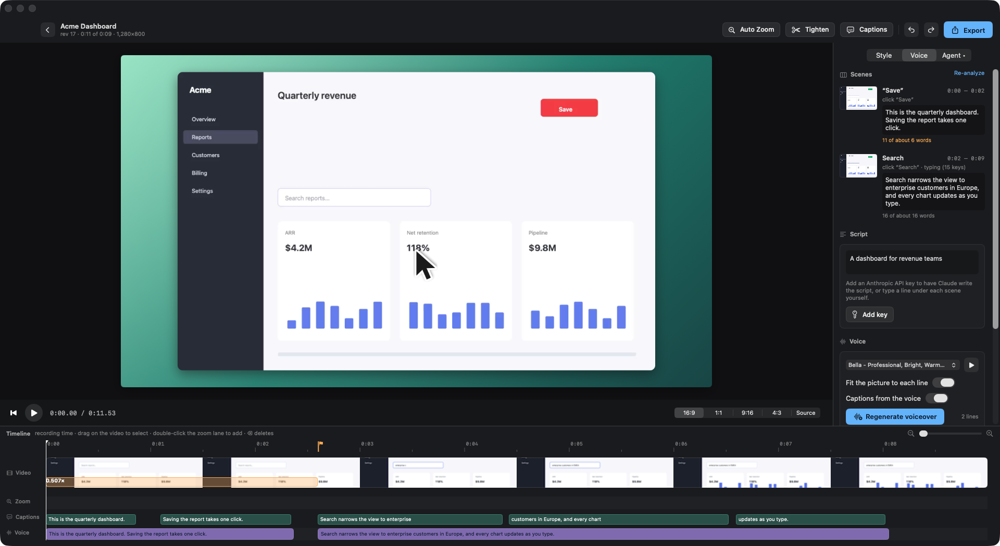
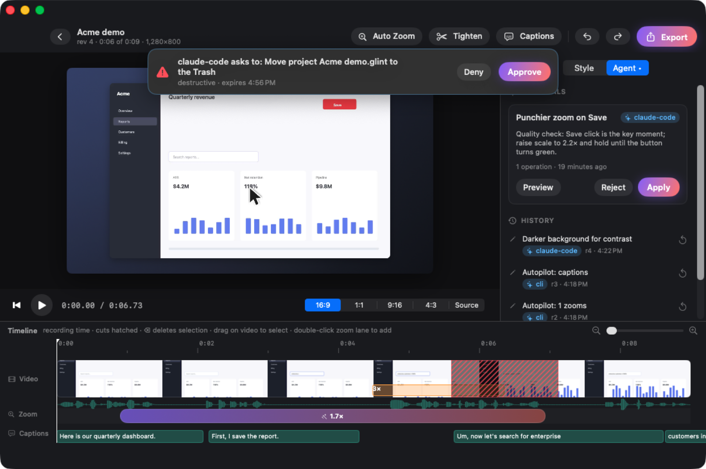

# Glint

**A native macOS screen recorder and editor for product demos, built so AI agents can do everything a person can.**

Record a take; Glint logs the pointer, clicks and typing next to the video, then turns the raw take into a polished demo. It adds spring-animated zooms that anticipate each action, a smooth redrawn cursor, tightened pauses, captions, a styled background, and vertical/square/GIF variants. It can also narrate the take: it splits the recording into scenes, reads what is on screen, has Claude write a script, speaks it with an ElevenLabs voice and retimes the picture to fit. Every recording, edit, render and quality check is available in three places: the app, the `glint` CLI, and an MCP server. All three share one engine, so edits are attributed, undoable, revision-checked, and can come from a person and an agent at the same time.

<p align="center"></p>

## What it does

- **Record:** a display or window via ScreenCaptureKit (HEVC, up to 60 fps), plus system audio and optional microphone. Input tracking needs no permissions: it records keystroke *timing*, never the keys.
- **Facecam:** turn on Camera in the record sheet (or `glint record --camera`) and your camera records to its own track. It is drawn as a bubble over the screen: circle, square or wide, in any corner, mirrored by default, with a border and shadow. It follows your cuts and speed changes, stays put while the screen zooms and shrinks out of the way when it does. Captions keep clear of it. Adjust or hide it under Style › Facecam.
- **Auto zoom:** clicks and typing are clustered into zooms that start before each action and hold after it. Nearby zooms merge or pan instead of "pumping". A deterministic spring camera follows the cursor, with motion blur on fast moves.
- **Smooth cursor:** zero-lag smoothing that still lands exactly on each click, the recorded cursor images (arrow, I-beam, …) or Glint's own arrow, idle fade, and click ripples.
- **Tighten:** shortens silent pauses, cuts filler words, speeds up silent typing and idle waiting, and trims dead ends.
- **Captions:** on-device transcription (Apple SpeechTranscriber, with whisper as fallback) and readable lines with the active word highlighted.
- **Narration:** the take is split into scenes from your clicks, typing, app switches and markers; each scene gets a frame and its on-screen text (Apple Vision OCR, on device). Claude writes one line per scene from the frames and a brief you give it; you edit the lines; ElevenLabs speaks them with word timings. Clips land on a Voice lane, the picture is retimed so every scene lasts as long as its line, captions come from the word timings, and recorded audio ducks under the voice.
- **Look:** gradient or image backgrounds, padding, rounded corners, shadow, and 16:9 / 1:1 / 9:16 / 4:3 canvases (the square and vertical variants follow the cursor).
- **Export:** H.264, HEVC, ProRes, and GIF. Loudness is normalised toward −16 LUFS, with peak headroom. **Every output is measured**: duration vs edit, resolution, black or frozen frames, sharpness, loudness and clipping.
- **Shots, audio and overlays** (on main, after 0.4.0): import movies as shots and reorder, split or trim them; add a music bed, your own voiceover or sound effects; callouts (text, arrows, boxes, spotlight) and privacy masks (pixelate, blur, solid) drawn into every render; dip transitions; SRT/WebVTT captions timed to the edit; cut words from the transcript; reusable style presets.
- **Reliable recording** (on main): pause and resume, crash recovery from 2-second fragments, a preflight check before each take, and window takes that follow a moved window.
- **Non-destructive:** media is never touched. The project is an open folder of JSON plus standard media files. Delete a recording from its card (hover, or right-click) or File › Move Project to Trash; it goes to the Trash, so Finder can put it back.

## Agent-native

| | |
|---|---|
| **One engine** | The app, CLI and MCP call the same `GlintService`/`Engine`. An agent's edit shows up live in the open editor, with a banner. |
| **Typed, reversible edits** | 45 operation kinds become transactions with automatically derived inverse patches: undo/redo, selective revert, and `expected_revision` to prevent clobbering. |
| **Proposals** | Planners and agents propose edits with a rationale. Agents can render frames or contact sheets *of the proposal* and score it before anyone applies it. |
| **Measurable quality** | Edit checks (zoom coverage and pumping, cursor in view while zoomed, camera speed, dead air, caption reading speed…) and render checks, each with a verdict and a fix hint. |
| **Approvals** | Capture, destructive and external actions (sending frames to Anthropic, a script to ElevenLabs) return `approval_required`. A person approves in the app or with `glint approve` (interactive terminal only). Agents can't approve, and can't read or set API keys. |
| **Walkthroughs** | Agents can record an app they're driving and report actions (`glint_record_action`), so automation that doesn't move the real cursor still gets zooms and a natural cursor. |
| **Recipes and evidence** | A versioned recipe gives each scene a stable ID and expected outcomes. Evidence is verified, failed or needs review; a click is never proof. Re-record one scene after a product change and swap it in, keeping every other edit. |
| **Durable jobs** | Renders and production checks run as jobs with progress, cancel, retry and resume. Nothing is reported ready until its checks pass. |

<p align="center"></p>

## Install

Requires an Apple Silicon Mac running macOS 26 or later. [Download Glint 0.4.0](https://github.com/drewsephski/glint/releases/download/v0.4.0/Glint-0.4.0.dmg), drag Glint to Applications and open it. The app and installer are Developer ID signed and notarized by Apple. See [GitHub Releases](https://github.com/drewsephski/glint/releases) for release notes, the ZIP download, and checksums.

Glint is free. Recording, zooms, cuts, captions and export run entirely on your Mac. Narration writing defaults to your Claude or ChatGPT subscription through the vendor CLI. Sign in under Glint › Settings › Account. An Anthropic API key under Narration is an alternative; ElevenLabs still requires its own key for voice synthesis. Scene frames and facts leave the Mac for Anthropic (Claude or API key) or OpenAI (ChatGPT). Glint does not read or transfer CLI credentials. They are stored in your macOS Keychain and are never part of the app.

## Connect your agents

Open Glint. The **Agents** section on the home screen (also in Glint › Settings) shows Claude Code, Codex (CLI, IDE extension, and the Codex and ChatGPT apps) and Claude Desktop with a **Connect** button for each, or **Connect All**. From a terminal, the same thing is:

```bash
/Applications/Glint.app/Contents/Helpers/glint connect          # every agent that's installed
glint connect --status                                           # after "Install" under Command line, or `glint install-cli`
```

| Agent | What Glint configures |
|---|---|
| Claude Code | `claude mcp add-json --scope user glint …`: every folder, terminal, IDE and desktop sessions |
| Codex | `[mcp_servers.glint]` in `~/.codex/config.toml` (CLI, IDE extension and app), with a 15-minute tool timeout for long renders |
| Claude Desktop | `mcpServers.glint` in `claude_desktop_config.json` (restart Claude afterwards) |
| Cursor, VS Code, Windsurf, Zed | **Other Clients** copies the right snippet for each (they use different shapes) and says where to paste it; `glint connect --print` prints them all |

Glint starts its server once to check it answers before changing anything, changes only its own entry, keeps a `.glint-backup` of any file it edits, and has Codex read an edited `config.toml` before saving it. If you move Glint.app later, it repairs entries that point at the old location.

### Chat with an agent in the editor

The editor's **Chat** tab talks to Claude Code or Codex about the open project: "tighten the pauses and add zooms", "make a 30-second vertical version", "review the edit". Glint runs the agent's own CLI in the background with Glint's tools attached to this project, using your existing Claude or ChatGPT sign-in (no API key). You see its tool calls as they happen, its edits appear live and can be undone, and bigger changes arrive as proposals you preview and apply right under the chat. Follow-ups continue the same conversation, which is saved with the project.

When an agent records, the call goes to Glint.app (it opens in the background if needed), so macOS asks for Screen Recording permission once, for Glint, and not for your terminal, Codex or Claude. You see the agent's recording in Glint and can stop it there. Recording and anything sent online still waits for your approval.

## Quick start (from source)

Requires macOS 26 and Xcode 26 (Swift 6.2+).

```bash
scripts/build-app.sh                         # → build/Glint.app (the CLI is at Contents/Helpers/glint)
open build/Glint.app                         # record (⇧⌘R), or "Demo project"
build/Glint.app/Contents/Helpers/glint install-cli   # links `glint` into ~/.local/bin
build/Glint.app/Contents/Helpers/glint connect       # Claude Code, Codex, Claude Desktop (points them at this build)

glint sources                                # displays and windows
glint record --display 2 --duration 20       # → ~/Movies/Glint/Recording ….glint
glint autopilot -v landscape -v portrait     # tighten + zoom + captions + render + measure
glint qc                                     # edit quality checks
glint history                                # who changed what (undo/revert any of it)
glint demo-project --voice                   # synthetic project, no permissions needed

glint keys set anthropic && glint keys set elevenlabs   # once (Keychain); or export ANTHROPIC_API_KEY / ELEVENLABS_API_KEY
glint scenes                                 # split into scenes, frame + on-screen text each (on device)
glint narrate --brief "Acme Notes, for new users"       # Claude writes one line per scene; edit with --set s2="…"
glint voices                                 # ElevenLabs voices on your account
glint voiceover --voice Rachel --apply       # speak it, fit the picture, caption it
glint demo-project --narration               # a finished narrated example (system voice, no keys)

glint add-clip ~/Movies/intro.mov --at 0     # insert a shot (edits keep their content)
glint add-audio bed.m4a --kind music         # music bed: loops, fades, ducks under narration
glint redact --start 2 --end 9 --rect 0.6,0.05,0.35,0.08 --mode solid
glint callout box --start 3 --end 6 --rect 0.7,0.08,0.2,0.1
glint subtitles export --format vtt          # timed to the edited output
glint cut-words --phrase "you know" --apply
glint job start --kind production            # check, repair, render, inspect; "needs_review" unless everything passes
glint pause / glint resume / glint recover   # control a take in progress, rebuild an interrupted one
```

See [docs/AGENTS.md](docs/AGENTS.md) for the agent workflow and all 65 tools.

## Documentation

- [Architecture](docs/ARCHITECTURE.md): engine, project format, capture, motion, rendering, surfaces
- [Agents](docs/AGENTS.md): MCP/CLI workflow and the generated tool reference
- [Research](docs/research/README.md): REA studies of [Screen Studio](docs/research/screen-studio.md) and [ScreenKite](docs/research/screenkite.md) (confirmed vs inferred), [frameworks and the reelbird evaluation](docs/research/foundations.md)
- [Testing](docs/TESTING.md): automated suite, real recordings, end-to-end agent walkthrough, measured results
- [Enhancements](docs/ENHANCEMENTS.md): the November 2026 audit, acceptance criteria and evidence
- [Known gaps](docs/GAPS.md)

## Development

```bash
swift build                                  # all targets
swift test                                   # 117 tests: core, narration, shots/overlays/jobs/recipes, real media pipeline, capture recovery, MCP
python3 scripts/e2e/agent_walkthrough.py build/Glint.app/Contents/Helpers/glint /tmp/glint-e2e   # real recording, end to end
```

`scripts/release.sh` builds the signed DMG and zip in `build/release/` (notarized when `GLINT_NOTARY_PROFILE` is set).

See [Release setup](docs/RELEASING.md) for Apple credentials, notarization, verification, and uploading installers.

### Screen Recording during development

Local builds use `dev.glint.Glint.dev` (display name **Glint Dev**) so their privacy grants stay separate from the installed **Glint** release. `scripts/build-app.sh` selects a single Apple Development certificate, falling back to a single Developer ID Application certificate. Set `GLINT_DEV_SIGN_IDENTITY` explicitly when you have multiple identities. Keep the same identity and bundle ID across rebuilds: ad-hoc signatures use a binary hash that changes when the executable changes. Ad-hoc builds require `GLINT_ALLOW_ADHOC=1` and may need permission again after rebuilding. `GLINT_SIGN_IDENTITY` remains the distribution-signing override used by `scripts/release.sh`.

Opening the recording sheet and checking sources never explicitly requests permission. Source enumeration first checks the current process's grant; concurrent queries share one request, and a rejected grant blocks automatic retries. **Check Again** explicitly retries after a Settings change. This cannot suppress macOS's own periodic reauthorization prompts. The **System picker** authorizes the selected content for that session without requiring a persistent full-screen grant ([Apple's explanation](https://developer.apple.com/videos/play/wwdc2023/10053/)).

If Settings shows access but Glint cannot list sources, check the app name and path shown in the help, then reopen that copy if needed. Switching from an ad-hoc build to a certificate-signed build may require a one-time new grant. Glint does not reset your privacy settings automatically or treat unrelated stream failures as permission denials.

`GLINT_HOME` and `GLINT_PROJECTS` redirect the support folder (approvals, policy, API keys) and the default project folder, for example when testing. `GLINT_NARRATION_MODEL` overrides the script-writing model (default `claude-haiku-5-5`).
